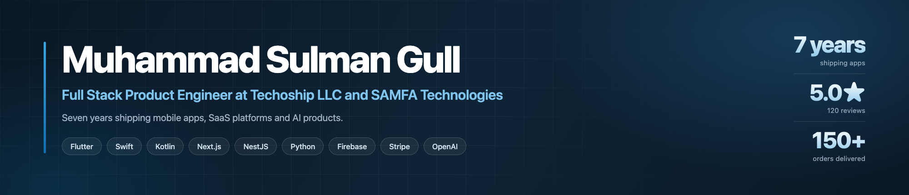

  

<h3 align="center">Muhammad Sulman Gull</h3>

Senior Mobile Engineer · Flutter, native iOS and Android Programming Manager at SAMFA Technologies · founder of <a href="https://techoship.com/?utm_source=github&utm_medium=profile">Techoship LLC</a>

---

I've been shipping production apps since 2019: Flutter where one codebase serves both platforms, Swift and
Kotlin where it doesn't, and the backends and admin consoles behind them. I lead mobile delivery at SAMFA
Technologies, run my own product studio, and take on freelance work.

Most of that code is under contract and stays private. My apps, past projects and experience are on
**[msulmangull.github.io](https://msulmangull.github.io)**, and the full case studies are at
[techoship.com](https://techoship.com/work?utm_source=github&utm_medium=profile).

### Open source

- **[Random URL Reloader](https://github.com/Techoship/random-url-reloader)**: a Manifest V3 Chrome extension that reloads pages on your own schedule, one session per tab. It's vanilla JS that survives service-worker suspension.

### My own apps on Google Play

- **[Focusara](https://play.google.com/store/apps/details?id=com.techoship.focusara)**: a wellbeing coach whose AI runs entirely on the phone, in Flutter with Gemma 3.
- **[Zimmati](https://play.google.com/store/apps/details?id=com.techoship.zimmati)**: expense splitting with a ledger that can't drift.
- **[Qorvyn Run](https://play.google.com/store/apps/details?id=com.techoship.qorvynrun)**: a 2D platformer built with Flutter and Flame.

### Client work, named with permission

| | |
|---|---|
| [Firnela](https://techoship.com/work/shift-staffing-platform?utm_source=github&utm_medium=profile) | Hospitality staffing marketplace: Flutter apps, a Next.js console, a NestJS API and 28 scheduled jobs |
| [Heyday City Guides](https://techoship.com/work/local-discovery-platform?utm_source=github&utm_medium=profile) | What's on tonight: Flutter app, a 69k-line Flutter Web console, NestJS |
| [Tended Health Pro](https://techoship.com/work/dementia-caregiving-app?utm_source=github&utm_medium=profile) | Dementia caregiving app: native Android shell, Google Play Billing from a web page, Emergency Mode |

More under NDA, with client names withheld: AI interior redesign on native iOS and Android, an offline-first
POS and ERP, a drone escort for campus safety, voice-to-task project management in Arabic and English, and a
restaurant platform. All are at [techoship.com/work](https://techoship.com/work?utm_source=github&utm_medium=profile).

### What I work on

- **AI in real products:** on-device models, speech to task, image generation behind server-side keys and verified purchases. Not chatbot demos.
- **Mobile:** Flutter, and native Swift and Kotlin when the hardware demands it.
- **Backends:** NestJS, Next.js, FastAPI, Django. I've moved two live products from Python to NestJS without downtime.
- **The parts people forget:** payments, offline data, store review, and the admin console someone has to run the business from.

### Stack

`Flutter` `Dart` `Swift` `SwiftUI` `Kotlin` `Jetpack Compose`
`TypeScript` `Next.js` `NestJS` `Python` `FastAPI` `Django`
`PostgreSQL` `Firebase` `Supabase` `Stripe` `OpenAI` `Azure Speech`

### Track record

`5.0 ★ on Fiverr from 120 reviews` · `150+ orders` · `100% on-time delivery` · `Top Rated on Upwork`

---

  <a href="https://msulmangull.github.io"><b>msulmangull.github.io</b></a> ·
  <a href="https://techoship.com/?utm_source=github&utm_medium=profile">techoship.com</a> ·
  <a href="https://www.linkedin.com/in/msulmangull">LinkedIn</a> ·
  <a href="https://twitter.com/msulmangull">X</a>

